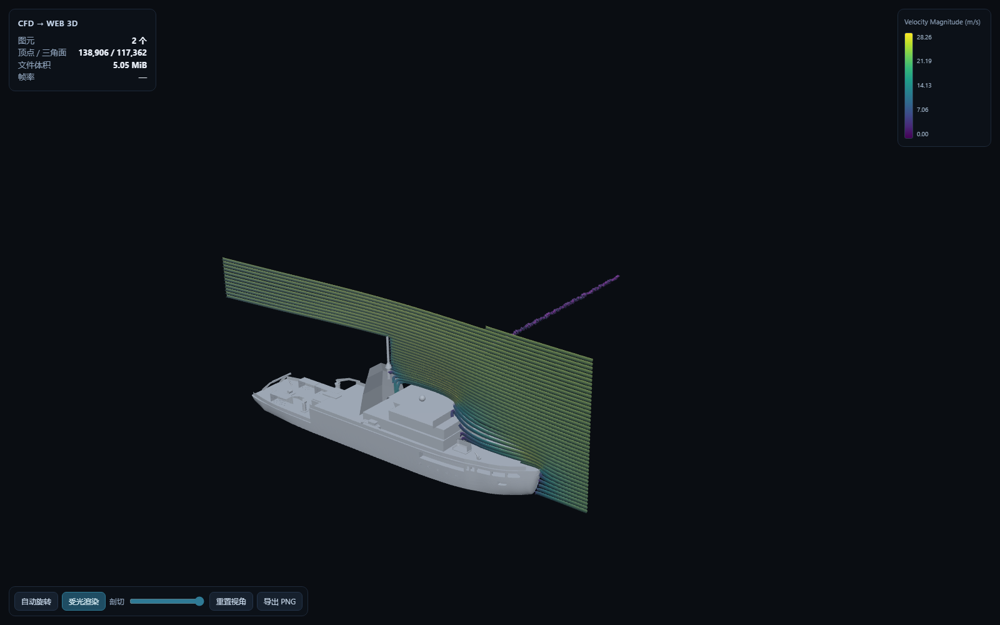

# cfd-web3d

CFD 结果 → 网页里能转的 3D（glTF/GLB + three.js）。这是 DSH 的 agent skill：
**SKILL.md 是唯一权威**，README 只讲怎么用这套脚本。



> 上图：极地号 0° 风载，中线面流线（速度着色）+ 船体，three.js 实时渲染。

## 内容

| 路径 | 说明 |
|---|---|
| `SKILL.md` | 技能本体：路线选择、各软件按钮/API、八个坑、体积预算、验收清单 |
| `scripts/field_streamlines.py` | 场数据（npz / legacy .vtk）→ 流线 → 管状 GLB + meta，只依赖 numpy |
| `scripts/comsol_export_gltf.py` | COMSOL 6.3 原生导出：`--list` 看哪些绘图组能导，`--plot` 导 GLB |
| `templates/cfdpost_hardcopy_gltf.cse` | ANSYS CFD-Post 会话模板（`gltf` / `glb2`） |
| `web/viewer.html` | three.js 查看器，CDN 引入，免构建 |
| `web/serve.mjs` | 本地静态服务器（.glb / .meta.json 的 MIME 已配好） |

## 30 秒跑通（用自带的示例场景）

```powershell
cd assets/cfd-web3d
node web/serve.mjs 8787
# 浏览器打开 http://127.0.0.1:8787/viewer.html?src=/scene.glb
```

自己的数据：

```powershell
# 1) 场数据 -> 场景
& 'D:\program\py\python.exe' scripts/field_streamlines.py --npz mid.npz --out web/scene.glb
# 2) 起服务
node web/serve.mjs 8787
# 3) http://127.0.0.1:8787/viewer.html?src=/scene.glb&meta=/scene.meta.json
```

## 依赖

- Python 3.10+ 且 `numpy`（`field_streamlines.py` / `comsol_export_gltf.py` 后者还需要 `mph` + JPype 和本机 COMSOL）
- Node 18+（只用来起静态服务）
- three.js 走 CDN（`cdn.jsdelivr.net/npm/three@0.186.1`），内网离线时把它换成本地 node_modules 即可

## 谁在用它

- `E:\DSH-Ansys\.dsh\skills\cfd-web3d\` —— ANSYS 工作区的可选工作流（镜像）
- `dsh-comsol/assets/cfd-web3d\` —— COMSOL 插件的第二个 skill（**以此处为准**）

改动请先改这里，再同步镜像；两个目录内容应保持一致。
